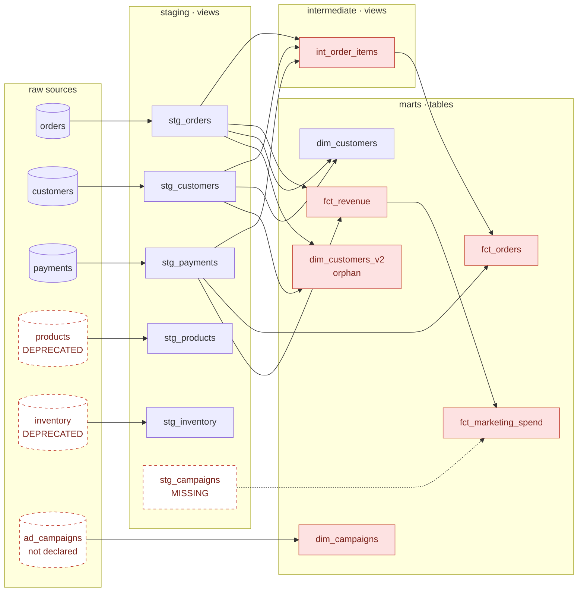

# dbt Anti-Patterns Testbed

A small **dbt** project (`jaffle_shop`: orders, customers, payments, marketing) that is **intentionally flawed**. Every defect is marked with a comment in the SQL or YAML. It is a fixture for testing automated dbt code review, linting and documentation checks, and a catalogue of common dbt mistakes.

> **Do not use these models as a reference implementation.** The bugs are on purpose.


## Lineage

Solid red nodes are models with a planted defect. Dashed nodes are missing or deprecated.



Layers: `staging` and `intermediate` are views, `marts` are tables (see `dbt_project.yml`).

## Planted defects

| # | Defect | Where |
|---|---|---|
| 1 | **Fan-out join.** An order-grain table is joined to payment-grain data without aggregating, so orders with several payments are duplicated. | `models/marts/fct_orders.sql` |
| 2 | **Fan-out join on mismatched grain.** Campaign-grain data is joined to daily revenue by date, and a second grain problem is flagged in the comments. | `models/marts/fct_marketing_spend.sql` |
| 3 | **Broken `ref`.** References `stg_campaigns`, which does not exist. | `models/marts/fct_marketing_spend.sql` |
| 4 | **Duplicate metric definitions.** `net_revenue_usd` is computed three different ways: `* 0.97`, `* 0.95`, and `order_amount - paid`. | `fct_revenue.sql`, `fct_marketing_spend.sql`, `int_order_items.sql` |
| 5 | **Orphan model with conflicting logic.** `dim_customers_v2` segments on lifetime value, while `dim_customers` segments on order count. Nothing references the v2. | `models/marts/dim_customers_v2.sql` |
| 6 | **Deprecated sources still modelled.** `products` and `inventory` are marked archived or decommissioned, but staging models still read them. | `sources.yml`, `stg_products.sql`, `stg_inventory.sql` |
| 7 | **Undeclared source.** `dim_campaigns` reads `raw.ad_campaigns`, which is not listed in `sources.yml`. | `models/marts/dim_campaigns.sql` |
| 8 | **Missing documentation.** A source table has no description, and several mart columns have none. | `sources.yml`, `models/marts/schema.yml` |
| 9 | **Missing tests.** No `unique` / `not_null` on the marketing model, and almost none on the orphan model. | `models/marts/schema.yml` |
| 10 | **Personal-data columns propagated.** Names and email flow from staging into an intermediate model and a fact table that feeds BI and support tooling. | `int_order_items.sql`, `fct_orders.sql` |

## Using it as a fixture

- Run your reviewer, linter or `dbt` checks against this project and compare what they catch with the table above.
- The PR template in `.github/PULL_REQUEST_TEMPLATE/default.md` has a checklist (compiles, tests pass, YAML updated, descriptions added) that these models are built to fail.

```bash
# needs a dbt profile named "jaffle_shop" (see dbt_project.yml)
dbt deps
dbt compile      # fails on the broken ref in fct_marketing_spend
dbt test
```

No warehouse credentials are stored here: `profiles.yml` is git-ignored, and the project contains only SQL and YAML, no data.

## Limitations

- There is no seed data, so the models can't run against a real warehouse as is.
- The defect list is based on the comments in the code, not on running a tool. Not every item may be caught by `dbt compile` alone.
